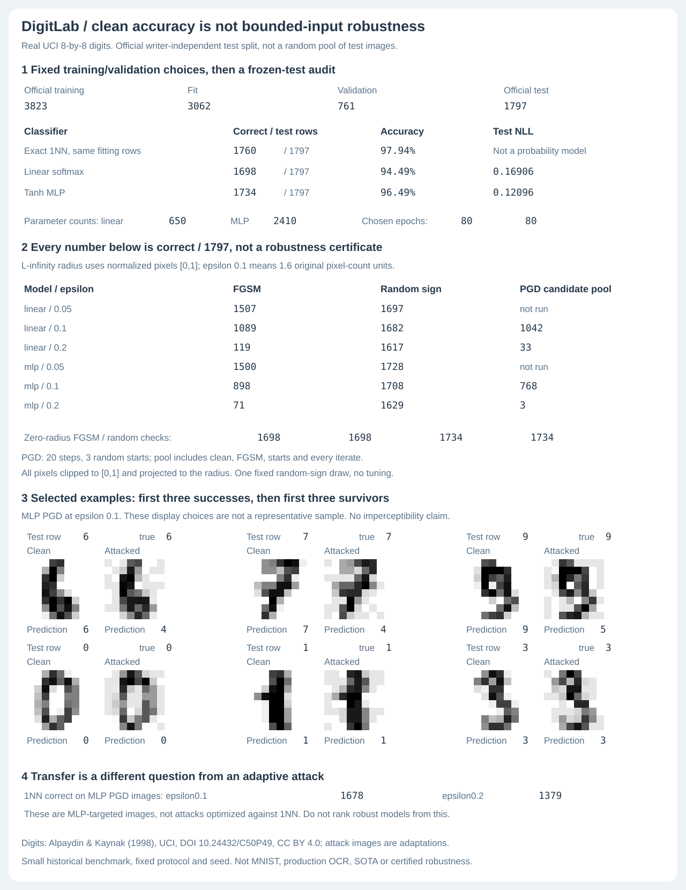

# DigitLab

Real handwritten-digit training and bounded-input attack audits in **NumPy only**.
No PyTorch, JAX, scikit-learn models, autograd engine, paid APIs or pretrained
weights. A linear softmax model and a 32-hidden-unit tanh MLP are trained from
scratch with manual parameter and input gradients. A strong exact 1NN baseline
is retained even when it wins.



## Real data, with the official boundary preserved

This is UCI Optical Recognition of Handwritten Digits, **not MNIST**. Each input
is 64 block counts in 0..16, normalized by the fixed metadata scale 16. The
original 3,823-row training file and separate 1,797-row test file are bundled
with SHA-256 checks and [CC BY 4.0 attribution](digitlab/data/LICENSE.md).
UCI reports 30 training writers and a different 13 test writers. Numeric files
have no individual writer IDs, so that assertion is source-reported, not
independently verified here.

Only the official training file is partitioned: within each class, sort feature
SHA-256 hashes and hold out the first floor(20%) rows. That gives **3,062 fitting
rows and 761 validation rows**. All official test rows remain separate. Exact
feature-hash overlap is zero across all three partitions; this does not rule
out similar handwriting or prove writer-disjoint validation.

The fixed protocol, fitting/validation indices and checkpoint choices are
saved. Both models train for 80 epochs using seeded shuffled minibatch SGD
with momentum, checking epochs 10, 20, 40 and 80. Selection minimizes validation
NLL, not test performance or validation accuracy. Both select epoch 80. The MLP
has *higher* validation accuracy at epoch 40, but that was not the declared
selection criterion. Test examples were first parsed after model selection and
all attack settings were fixed. Subsequent unchanged re-evaluations check
reproduction; no test-driven hyperparameter or seed selection is performed.

## The baseline wins on clean digits

| Classifier, all on the same 3,062 fitting rows | Official test correct | Accuracy | Test NLL |
|---|---:|---:|---:|
| Exact Euclidean 1NN | 1,760 / 1,797 | 97.94% | Not a probability model |
| Linear softmax, 650 parameters | 1,698 / 1,797 | 94.49% | 0.16906 |
| Tanh MLP, 2,410 parameters | 1,734 / 1,797 | 96.49% | 0.12096 |

1NN uses exact squared Euclidean distances with earliest fitting-row index on
exact ties. It has no tuned `k`, feature scaling fit or hidden all-training-data
advantage. It stores the same fitting examples used by both trained models.
These are descriptive results on one historical benchmark and fixed protocol,
not superiority or SOTA claims. Test confusion matrices and every prediction
are included in the [complete report](digitlab/artifacts/report.json).

## Better clean accuracy does not certify input robustness

White-box attacks know the selected model and true labels. Pixels stay in
[0,1], with L-infinity radius epsilon around each original input. Normalized
**epsilon 0.1 corresponds to 1.6 original 0..16 block-count units**. The continuous
attack domain is not restricted to valid integer-count handwriting. No human
label-preservation, imperceptibility or real-world OCR threat claim is made.

At epsilon 0.1 on the MLP:

- Clean: 1,734 / 1,797 correct.
- One fixed random-sign control: 1,708 / 1,797 correct.
- FGSM: 898 / 1,797 correct, fooling 836 of the 1,734 initially correct rows.
- PGD candidate pool: 768 / 1,797 correct, fooling 966 of those initially correct rows.

PGD uses 20 projected steps and three seeded random starts, step size epsilon/4.
The per-row candidate pool includes clean input, FGSM, every start and every
iterate. It prefers any misclassification, then larger true-label cross entropy
among equally successful candidates. This explicit pool cannot lose a clean or
FGSM misclassification, but it is still a finite attack, **not a certificate or
optimal attack**. Surviving these attacks is not proof of robustness. Attacks
are also reported at other fixed-in-advance radii, including zero-radius identity.
A single seeded random-sign draw is a descriptive control, not a confidence
interval or isolated causal mechanism estimate.

1NN gets 1,678 correct on the MLP's epsilon-0.1 PGD images. That is **transfer**,
not an adaptive attack on 1NN. Do not rank model robustness from that comparison.
The six shown image pairs are explicitly selected: first three initially
correct attack successes, then first three survivors, at MLP PGD epsilon 0.1.
They are not a representative test sample.

## Run offline

Python 3.10+, NumPy 2.2.6. The dataset, selected models and report are bundled.
No network access is needed after dependency installation.

```bash
python -m pip install -e .
OPENBLAS_NUM_THREADS=1 python -m digitlab demo
OPENBLAS_NUM_THREADS=1 python -m digitlab train --artifacts runs/local
OPENBLAS_NUM_THREADS=1 python -m digitlab evaluate --artifacts runs/local
OPENBLAS_NUM_THREADS=1 python -m unittest discover -s tests -v
OPENBLAS_NUM_THREADS=1 bash examples/demo.sh
```

`demo` reads the published frozen report. `train` and `evaluate` require an
explicit output directory, so they do not overwrite installed package data by
default. Models use strict JSON, not pickle. For normalized numeric features:

```bash
python -m digitlab predict --model digitlab/artifacts/mlp.json --input examples/input.json
```

Prediction JSON has exactly `features`, a nonempty numeric matrix matching the
model input width, at most 20,000 rows, values in [0,1], no bool/nonfinite values.
Files are at most 1 MB. Duplicate/unknown keys and malformed values exit 2 with
empty stdout. The model parser checks keys, dimensions, numeric types and finite
bounded parameters. These are inference checks, not a prompt-security product.

## Verification and limits

30 tests include **201 independent finite-difference parameter/input probes**
across linear and tanh models, explicit L2-gradient checks, stable extreme logits,
SGD descent, no input/RNG mutation, safe JSON round trips, official dataset hashes
and class counts, frozen split/selection rules, independent 1NN distances and tie
handling, attack domains and candidate retention, CLI errors, full retraining
without any test-loader call, and reproduction from saved selected models.
The figure binds **62 displayed value cells and 768 pixel values** and embeds
the complete report; a hidden prediction change changes its metadata.

Five CI jobs check Python 3.10-3.13 plus installed-wheel imports, bundled-data
access and JSON inference outside checkout. Saved report/figure reproduction is
exact; retrained floating weights use explicit tolerances across NumPy/BLAS
implementations. All test predictions and counts must agree. No cross-platform
bitwise training or hardware-time promise is made.

The project studies small grayscale digits. It is not production OCR, a
convolutional vision system, a general robustness benchmark or a new algorithm.
No private messages, employer data or customer data are used.

[Full protocol, equations, provenance and sources](METHOD.md).

## Attribution

Code, tests, fixtures, training and visualization are original project work,
MIT licensed. Data and adapted digit images retain their separate CC BY 4.0
license: Alpaydin, E. & Kaynak, C. (1998), *Optical Recognition of Handwritten
Digits*, UCI Machine Learning Repository, https://doi.org/10.24432/C50P49.
Source authors and UCI do not endorse the project. FGSM, PGD, softmax, tanh
backpropagation, momentum SGD and nearest neighbors are established methods,
not claimed inventions. Sources and distinctions are documented in METHOD.md.
