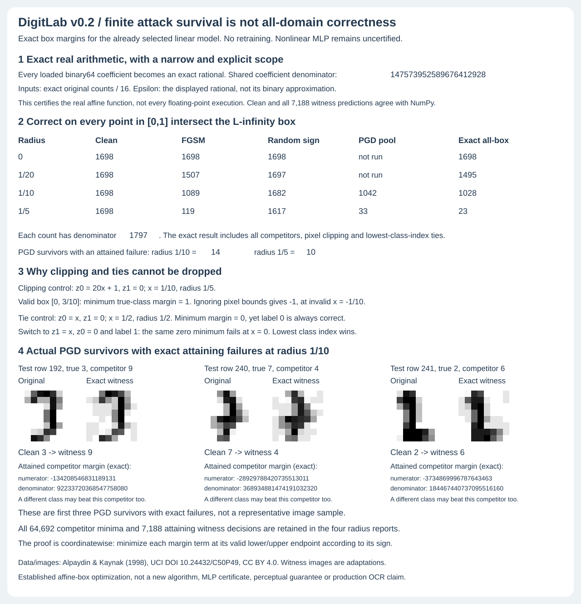

# Exact all-domain correctness for the fixed linear model

v0.2 adds a different question to the unchanged v0.1 finite-attack experiment:
for which official test examples does the selected **linear** classifier predict
the true label on **every** point of the clipped continuous input box?

This is not a new model or a post-test tuning exercise. No training, checkpoint,
seed, radius, original report or v0.1 figure changes. The same fixed radii are
used. The MLP and 1NN do not receive certificates from this method.



## What is exact, and what is not

Read the selected JSON weights as binary64, exactly as the existing model
loader does. Interpret each resulting float as an exact rational using
`Fraction(float)`, **not** `Fraction(str(float))` and not decimal rounding.
Every coefficient denominator is a power of two; multiply all coefficients by
their common positive denominator, 147573952589676412928, to get integers.
This scale does not affect the winning class or margin signs.

Original test counts divided by 16 are exact rationals. Radii are exactly
0, 1/20, 1/10 and 1/5, not the nearby binary approximations. Pixel endpoints and
integer-scaled coefficients allow all margin comparisons to use integers.
There are no optimizer tolerances or floating sign decisions in this proof.

The result certifies the **real affine function whose coefficients equal the
loaded binary64 values**. It does not prove correct rounding or bound errors
for arbitrary floating-point matrix multiplication at every possible point.
As a separate empirical check, all 1,797 clean predictions and all 7,188 selected
witness predictions agree with the NumPy implementation. That agreement on a
finite set is not an all-domain floating-point proof.

The original finite attacks use floating-point arithmetic and nominal decimal
radii. Their saved counts are shown for context, not silently relabeled as
exact rational computations. The attained rational failures below are checked
in the real model and, after conversion to binary64, also misclassified by
NumPy. No bound on arbitrary floating executions is inferred from those checks.

## Separable box proof

For true label y and competitor k, define

```
d_j = W[j,y] - W[j,k]
beta = b[y] - b[k]
lo_j = max(0, x_j - epsilon)
hi_j = min(1, x_j + epsilon)
m_k = beta + sum_j min(d_j * lo_j, d_j * hi_j)
```

This is the exact global minimum of `z_y - z_k` because the feasible set is a
Cartesian product of closed intervals and the objective is the sum of linear
coordinate terms. Set coordinate j to lo_j when d_j > 0, hi_j when d_j < 0,
and its original x_j when d_j = 0. That point attains the minimum. There is no
need to enumerate 2^64 corners or optimize cross entropy.

The classifier chooses the lowest class index among tied maximum scores.
It is correct everywhere in the box if and only if:

- m_k > 0 for every k < y; ties to a lower-index competitor are errors.
- m_k >= 0 for every k > y; ties to a higher-index competitor favor y.

Necessity follows because a violating competitor's minimum is attained at a
feasible point, where either that competitor or another class defeats y.
Sufficiency follows because every competitor loses (or loses its permitted
tie) at every feasible point. Different competitors can attain their minima
at different points. This does **not** weaken the result for 0/1 correctness,
which asks whether *any* competitor can defeat the true label.

If an error is possible, the reported witness uses the first violating
competitor in class order. Otherwise it uses the smallest-margin competitor,
with lowest-index tie handling. All selected witness scores are evaluated
against **every** class; the reported witness prediction can be a class other
than the selected competitor. Clean errors can never count as all-box correct
because the box contains its original input.

We do not claim this solves the global multiclass cross-entropy maximum. That
is a different objective from existence of a misclassification. The tutorial
source's multiclass loss upper bound is not the identity proved here.

## Results on the unchanged official test

All counts have denominator 1,797. All models/artifacts are fixed from v0.1.

| Rational radius | Clean | FGSM | Random sign | PGD pool | Exact real all-box correct |
|---|---:|---:|---:|---:|---:|
| 0 | 1,698 | 1,698 | 1,698 | not run | 1,698 |
| 1/20 | 1,698 | 1,507 | 1,697 | not run | 1,495 |
| 1/10 | 1,698 | 1,089 | 1,682 | 1,042 | 1,028 |
| 1/5 | 1,698 | 119 | 1,617 | 33 | 23 |

At nominal radius 0.1, the saved PGD pool has 14 surviving examples with an
attained exact failure; at 0.2, it has 10. The figure's three pairs are the
lowest test indices among the first group: 192, 240 and 241. This deterministic
diagnostic selection is not a representative sample or a new attack setting.
The exact margin numerators and denominators are visible and stored.

These counts are not a robust-model ranking against the MLP or 1NN. The MLP's
finite-attack counts remain empirical and 1NN transfer is not adaptive attack.
No real handwriting label-preservation or imperceptibility claim is made for
continuous perturbed block counts. Test accuracy still has sampling uncertainty;
this exact proof over each supplied box is not a population-accuracy proof.

## Why the details matter

**Clipping control.** Let `z0 = 20x + 1`, `z1 = 0`, original x=1/10 and radius
1/5. The valid clipped box is [0,3/10], with minimum true-label margin 1.
Using an unconstrained dual-norm formula on the un-clipped ball gives -1,
attained at invalid x=-1/10. The broad norm-ball bound can be conservative but
cannot be substituted for the exact clipped-domain result.

**Tie control.** Let `z0=x`, `z1=0`, original x=1/2 and radius 1/2. The minimum
margin is zero, yet label 0 is always correct, since it wins the tie at x=0.
Switch to `z1=x`, `z0=0` and true label 1: the same zero margin fails at x=0.
A single strict/non-strict test for every competitor would mishandle one case.

**Zero coordinates.** When a difference coefficient is zero, leave that pixel
at its original value. It has no effect on the margin and remains feasible.

## Reproduce without modifying installed artifacts

```bash
python -m digitlab box
OPENBLAS_NUM_THREADS=1 python -m digitlab box-audit --artifacts runs/box
OPENBLAS_NUM_THREADS=1 python -m unittest discover -s tests -v
OPENBLAS_NUM_THREADS=1 bash examples/demo.sh
python examples/render_box.py /tmp/box-audit.svg
cmp /tmp/box-audit.svg assets/box-audit.svg
```

`box` reads the saved summary, while `box-audit` requires an explicit output
directory and computes all 7,188 decisions. Four per-radius reports store all
64,692 margin minima (nine for each row/radius), exact scale, true/clean labels,
all-box status, selected competitor and actual selected-witness prediction.
Coordinates are reconstructed from the official hash-pinned source row,
selected model, competitor sign and radius. Summary SHA-256 values bind the
four full row reports. The figure embeds all four reports and summary, not just
the displayed counts. Changing an undisplayed margin changes the SVG.

45 tests preserve all 30 original tests and add all-vertex comparisons for 144
small multiclass certificates, 160 independent Fraction-based official-row
references, asymmetric ties, clipping, zero coefficients, nested domains,
loaded-binary rather than decimal coefficient semantics, invalid input cases,
full exact report/CLI reproduction, 26 displayed figure cells and 384 exact
pixel values. Both complete figures are reproduced byte-for-byte. The installed
wheel includes eight modules, both figures' source artifacts and six CLI modes;
CI exercises the installed exact audit outside checkout.

## Sources and distinctions

Read November 8, 2026. Original code and the coordinatewise proof implementation
are project work; the optimization method is established, not an invention.

- [Adversarial Robustness: Theory and Practice, Chapter 2, linear models](https://adversarial-ml-tutorial.org/linear_models/), tutorial by Zico Kolter and Aleksander Madry. Norm-ball linear-margin optimization and the distinction between binary loss exactness and multiclass loss bounds. The tutorial explicitly notes its simple example omits [0,1] clipping. We implement clipping and 0/1 competitor comparisons, not its PyTorch/MNIST training code.
- [On Exact Solutions of the Inner Optimization Problem of Adversarial Robustness](https://arxiv.org/html/2208.09449v3), primary research. Context for distinctions among model classes, objective functions and norm constraints. We do not claim reproduction of its broader results.
- [Adversarial Robustness Curves](https://arxiv.org/pdf/1908.00096), Goepfert et al., 2019. Distinguishes initially incorrect examples from margin failures and emphasizes dependence on the perturbation domain/radius. This project only claims the displayed clipped L-infinity boxes; it does not generalize one norm to another.
- [Python fractions documentation](https://docs.python.org/3/library/fractions.html), official. Exact float-to-rational semantics and the difference between `Fraction(0.1)` and `Fraction('0.1')`. We use APIs supported in Python 3.10+, not newer formatting helpers shown by the current documentation.
- [NumPy argmax documentation](https://numpy.org/doc/stable/reference/generated/numpy.argmax.html), official. First occurrence wins equal maxima; the proof implements the same class order with exact integer scores.
- [UCI Optical Recognition of Handwritten Digits](https://archive.ics.uci.edu/dataset/80/optical+recognition+of+handwritten+digits), primary data, Alpaydin & Kaynak (1998), DOI 10.24432/C50P49. Original split, block-count domain and CC BY 4.0 attribution. [Data notice](digitlab/data/LICENSE.md).

The original FGSM/PGD training and evaluation references and their limitations
remain in [METHOD.md](METHOD.md).
