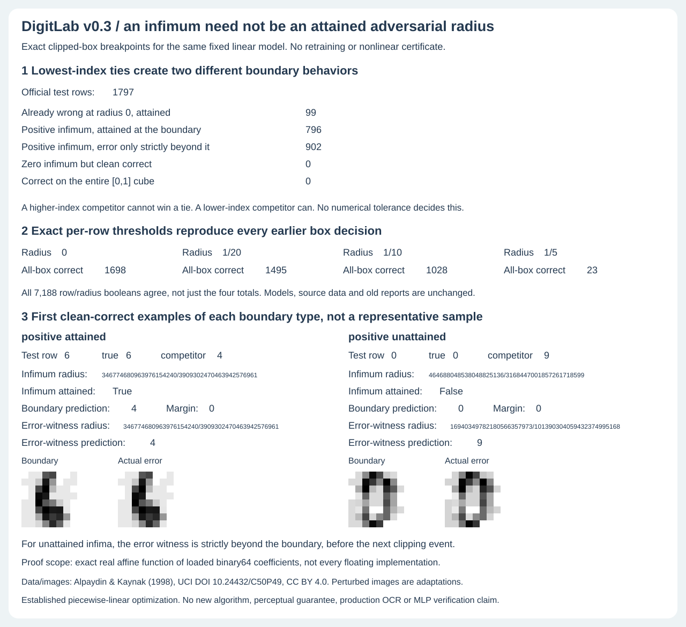

# Exact adversarial-radius infima, including boundary attainment

v0.3 asks a question the four v0.2 box counts do not answer: for each official
test example, what is the infimum L-infinity radius at which **some** point in
the clipped [0,1] pixel domain defeats its true label? Is that error attained
at the infimum, or do errors exist only strictly beyond a correct boundary tie?

This uses the same selected linear model, exact real interpretation of loaded
binary64 coefficients, original test data and lowest-class-index tie rule.
No training or old report changes. It does not certify the MLP, 1NN or every
floating-point execution. See [BOX.md](BOX.md) for coefficient semantics and
the distinction between a real affine proof and floating execution validation.



## Result, not a retuned benchmark

Of all 1,797 official test examples:

| Exact real-model outcome | Rows |
|---|---:|
| Clean error, infimum 0 and attained | 99 |
| Positive infimum, error attained at the boundary | 796 |
| Positive infimum, error only strictly beyond the boundary | 902 |
| Clean correct but zero unattained infimum | 0 |
| Correct everywhere on the entire [0,1] cube | 0 |

The two zero-count outcomes are still supported and tested with supplied
controls. They are not silently discarded as impossible in general.
All 7,188 earlier per-row decisions at radii 0, 1/20, 1/10 and 1/5 agree with
these thresholds, including equality and attainment, not merely the four totals.
The earlier all-box correct counts remain 1,698 / 1,495 / 1,028 / 23.

The figure selects the lowest clean-correct test index in each positive-infimum
category. This diagnostic selection is explicit, not a representative sample.

- Row 6, true label 6, lower-index competitor 4: radius
  `346774680963976154240/3909302470463942576961`, attained. The boundary margin
  is exactly zero and class 4 wins that tie. Boundary and error images are the
  same point.
- Row 0, true label 0, higher-index competitor 9: radius infimum
  `464688048538048825136/3168447001857261718599`, **not attained**. Class 0 wins
  the exact zero-margin boundary tie. A stored point strictly beyond the
  boundary, before the next clipping event, predicts class 9.

These are statements about the exact real affine model. Boundary predictions
are evaluated with exact rational scores and **are not** asserted to match
NumPy on a mathematical tie. Floating evaluation may resolve a tiny rounded
margin differently. The v0.2 finite witness agreement claim does not extend to
these newly constructed exact boundary ties. Images round rational pixel values
to grayscale only for display; their exact coordinates are stored and tested.

## Piecewise-linear proof

For true label y and each competitor k, use the v0.2 exact minimum margin

```
m_k(r) = beta + sum_j min(d_j * max(0,x_j-r), d_j * min(1,x_j+r))
d_j = W[j,y] - W[j,k]
beta = b[y] - b[k]
```

As radius increases, each adverse coordinate moves toward its relevant pixel
bound: lower when d_j>0, upper when d_j<0. Its contribution decreases with slope
`-abs(d_j)` until clipping. The clipping event is at x_j for a positive
coefficient and 1-x_j for a negative coefficient. Zero coefficients do not
contribute. Events at radius zero are already clipped and never enter the
active slope. Equal events are combined.

Between sorted event radii, `m_k` is affine and nonincreasing. Compute the exact
initial margin, sum the active absolute coefficients, and advance from event
to event. On the first segment reaching zero, solve its scalar linear equation
exactly. At an event, remove the newly clipped coefficients from the slope.
There are at most 64 distinct positive events per competitor in this model.
This avoids a numerical binary search, tolerance or finite attack grid.

Before searching, check the exact full-cube minimum
`beta + sum_j min(0,d_j)`. If it is positive, this competitor can never defeat
y. If it is zero and k>y, the minimum is a tie that y always wins, so this
competitor can never cause an error either. This handles zero-margin plateaus
without inventing an unattained error beyond a plateau.

If clean margin is negative (or zero with k<y), radius zero is an attained error.
If clean margin is zero with k>y but full-cube margin is negative, radius zero
is an unattained infimum. Otherwise:

- k<y: the first zero margin is an attained error.
- k>y: the first zero margin remains correct against k; errors exist immediately
  beyond it, so the infimum is not attained.

For an unattained infimum, choose the midpoint between the root and the next
strictly larger clipping event. Full-cube negativity guarantees a strictly
decreasing interval that supplies a genuine error there. This is a witness,
not a claim to attain the unattained radius. Store both boundary and error points.

The multiclass infimum is the least competitor infimum. If several competitors
share it, prefer an attained error, then lowest competitor index. Evaluate all
class scores at both reported points, rather than assuming the selected
competitor is the ultimate predicted class. If no competitor can defeat y on
the entire cube, report `infimum: null` and a full-cube-correct flag. Beyond
radius 1 the clipped domain is the same cube, so such a model stays correct
for all nonnegative radii.

For a global threshold t, all-box correctness at radius r is:

```
t is null OR r < t OR (r == t AND infimum_is_unattained)
```

The exact L-infinity distance of each stored error point equals its sample
radius. The boundary point for a positive attained threshold has distance t.
At an unattained threshold, the boundary remains true-label correct and the
sample radius is strictly greater than t. The supplied exhaustive small-model
checks verify these properties, including zero-radius and tied-threshold cases.

## Reproduce and inspect

```bash
python -m digitlab radius
OPENBLAS_NUM_THREADS=1 python -m digitlab radius-audit --artifacts runs/radius
OPENBLAS_NUM_THREADS=1 python -m unittest discover -s tests -v
OPENBLAS_NUM_THREADS=1 bash examples/demo.sh
python examples/render_radius.py /tmp/radius-audit.svg
cmp /tmp/radius-audit.svg assets/radius-audit.svg
```

`radius` is a read-only saved-report view. `radius-audit` requires an explicit
output directory. The report retains every row's exact infimum, attainment,
selected competitor, clean/sample predictions and sample radius, plus complete
rational boundary/error coordinates for the two display examples. Any row's
points can be reconstructed from its source row, selected model and competitor.
Hashes of the model and four earlier box reports bind the regression boundary.
The figure embeds the full radius report; an undisplayed row change changes it.

59 tests preserve all earlier 45 tests. New checks include 144 independent small
multiclass references that enumerate all vertex margins at every clipping knot
and interpolate the first crossing, rather than duplicating the active-slope
implementation. There are explicit plateau, zero-unattained, clean-error,
shared-infimum and clipped-slope controls. One hundred official boundaries are
checked against the separate v0.2 box solver at, below and beyond the threshold.
All rows regenerate exactly; all earlier box flags agree. The third figure
checks 32 displayed values, 256 rational pixels and complete hidden evidence.
The installed wheel has nine modules and eight CLI modes, with the radius audit
and saved-report parity verified outside checkout.

## Sources and limits

This is an original implementation of established separable affine/piecewise-
linear optimization, not a new algorithm. The sources and data attribution in
[BOX.md](BOX.md) and [METHOD.md](METHOD.md) remain applicable. Relevant source
URLs, read November 8, 2026:

- [Kolter and Madry, linear models tutorial](https://adversarial-ml-tutorial.org/linear_models/): exact linear-margin optimization on a norm ball and the distinction between binary loss exactness and multiclass loss bounds. The tutorial's simple example explicitly omits pixel clipping; the event derivation above supplies it. We do not claim its multiclass cross-entropy upper bound is an exact cross-entropy optimizer.
- [Goepfert et al., Adversarial Robustness Curves](https://arxiv.org/pdf/1908.00096): distinguishes error risk from decision-boundary distance and stresses the specified perturbation geometry. We make no cross-norm generalization.
- [Python fractions](https://docs.python.org/3/library/fractions.html): exact binary float conversion versus decimal string values, and rational arithmetic. Only Python 3.10+ supported APIs are used.
- [NumPy argmax](https://numpy.org/doc/stable/reference/generated/numpy.argmax.html): first occurrence wins equal maxima. This is the class-order rule being modeled, not a rounding guarantee.
- [UCI source data](https://archive.ics.uci.edu/dataset/80/optical+recognition+of+handwritten+digits): Alpaydin & Kaynak (1998), CC BY 4.0; original hashes and attribution remain unchanged.
- [Madry et al., Towards Deep Learning Models Resistant to Adversarial Attacks](https://arxiv.org/abs/1706.06083): background for the original finite PGD experiment, not a theorem supporting completeness of an iterative attack.

The domain is continuous normalized block counts, not a validated human
handwriting manifold. No imperceptibility, label-preservation, real-world OCR,
population generalization, all-floating-execution or nonlinear certificate is
inferred. The selected test examples show boundary behavior, not an empirical
frequency estimate for other data or a new classifier comparison.
